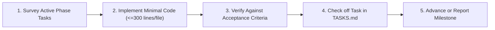

# Spec-Driven Phased Delivery

An operational methodology distilled from production software delivery for building multi-tier applications in strict, verifiable batches without regression or documentation drift.

## Core Delivery Rules

1. **Batch Integrity Over Speed:**
   - Never implement features across multiple phases in a single pass.
   - Complete only the designated tasks within the active phase (e.g., Phase 0 setup or Phase 1 catalog pipeline).
   - Stop and verify before advancing to subsequent phases.

2. **Acceptance Criteria as Test Spec:**
   - Every functional requirement (FR) in `Planning/PRD_Speqtus_Ordering_App.md` has an explicit acceptance criteria checklist.
   - A task is NOT complete when code is written; it is complete only when each acceptance criterion is verified.
   - If an edge case is unclear, check `Planning/AGENTS.md` or flag a `DECISION NEEDED` item rather than guessing.

3. **Full-Stack Verification Gates:**
   - **Database:** Verify RLS policies with both authorized and unauthorized personas before wiring frontend UI.
   - **Client:** Run strict TypeScript checks (`npx tsc --noEmit`) and verify responsive layout constraints on mobile and web viewports.
   - **Zero-Regression Guarantee:** Existing tests must pass before marking tasks complete.

4. **Zero Documentation Drift:**
   - As tasks are finished, update the corresponding checkboxes in `Planning/TASKS.md`.
   - Update `Planning/PRD_Speqtus_Ordering_App.md` status if requirements evolve.
   - Document any architectural decisions or client approvals in `Planning/DECISIONS.md`.

---

## Phased Workflow Lifecycle

## Detailed Checklist
For the complete step-by-step verification checklist for each phase, see:
- [Phased Execution Checklist](./references/phased_execution_checklist.md)
