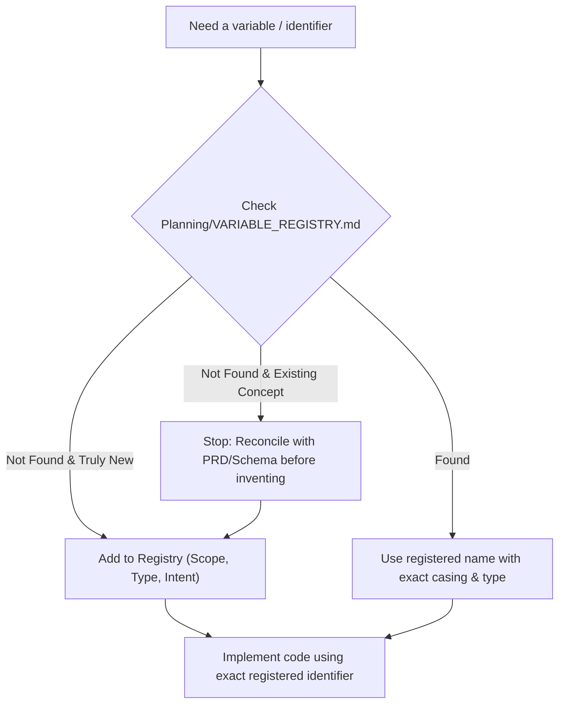

# Variable Registry & Identifier Governance

A deterministic skill and operational runbook for managing, looking up, and preserving critical variable names across database schemas, backend services, frontend components, and third-party integrations.

## Core Directives

1. **Never Guess or Invent Names:**
   - Before introducing, referencing, or binding a variable, column, parameter, or state property, check [Planning/VARIABLE_REGISTRY.md](../../Planning/VARIABLE_REGISTRY.md).
   - If an identifier already exists for that entity or concept, use it with exact spelling and casing.
   - If a new variable is required, register it immediately before writing implementation code.

2. **Strict Casing & Spelling Invariants:**
   - Exact casing matters: distinguish strictly between `snake_case` (DB columns), `camelCase` (TypeScript properties), `PascalCase` (Types/Interfaces/Components), and `UPPER_SNAKE_CASE` (Constants/Env vars).
   - If a conversion occurs across layers (e.g., Postgres `order_status` -> TS `orderStatus`), both must be mapped in the registry as linked aliases.

3. **Single Source of Truth Maintenance:**
   - Keep [Planning/VARIABLE_REGISTRY.md](../../Planning/VARIABLE_REGISTRY.md) up-to-date with every code change.
   - When renaming or deleting a variable, update all code references and log the change in the registry change log.

---

## Operational Workflow

### Step 1: Pre-Implementation Lookup
Before writing any code (queries, types, components, edge functions):
- Search `Planning/VARIABLE_REGISTRY.md` for the entity or concept.
- Verify existing names (e.g., is the product variant code `art_no`, `artNo`, or `sku`? PRD specifies `art_no`).
- Do not create synonyms or aliases unless explicitly required by a boundary serialization layer.

### Step 2: Registering a New Variable
When a new domain variable or shared state is legitimately introduced:
1. Append an entry to the appropriate section of `Planning/VARIABLE_REGISTRY.md`.
2. Populate all table columns:
   - **Variable Name:** Exact casing and syntax.
   - **Scope / Layer:** e.g., `Database (Postgres)`, `Client State (React Native)`, `API / Edge Function`, `Env Variable`.
   - **Type / Shape:** e.g., `UUID`, `string`, `'draft' | 'pending'`, `Record<string, number>`.
   - **Intended Usage & Context:** Where it is used and what business logic it represents.
   - **Source of Truth / File:** File path or PRD reference defining it.

### Step 3: Renaming or Deprecation
When refactoring or removing a variable:
1. Search the workspace to replace all occurrences.
2. In `Planning/VARIABLE_REGISTRY.md`, move or mark the variable as `[DEPRECATED]` with a reference to the replacement identifier.
3. Record the change in the **Changelog** section of the registry.

---

## Detailed References

- [Registry Markdown Template](./references/registry_template.md): Standard layout and domain tables for `VARIABLE_REGISTRY.md`.
- [Variable Governance Rules](./references/variable_governance_rules.md): Casing conventions, naming rules, and cross-layer serialization patterns.
